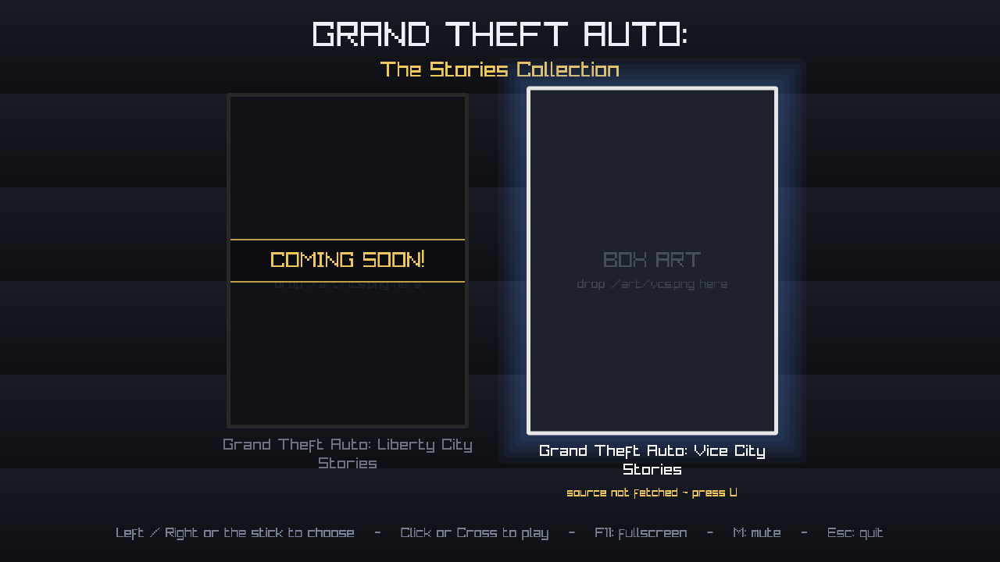

# The Stories Collection launcher

The front end for the recompiled PS2 GTA games. One window, one menu, and each
game is a card you click.



Two ports share it — **Liberty City Stories** and **Vice City Stories** — because
they are the same runtime underneath; only the generated game code differs. LCS
is still in progress, so its card says `COMING SOON!` until it is ready.

## Built with AI

This launcher was written with substantial help from AI: the code came from
coding assistants under human direction, and every change was built and run
before it was kept.

It is said plainly, and early, because some people would rather not use software
made this way. That is a fair position to hold, and you have found out before
spending an evening on it rather than after.

## What it does today (phase 1)

- The menu: two cards with **your own box art**, mouse hover and d-pad / stick
  navigation, click or Cross to play, Esc to quit. **Every action has a controller
  button as well as a key**, and the hints name whichever you are using: the bottom
  face button plays, the left one fetches the source, the top one builds, and the
  right one backs out or stops a build.
- **Fullscreen by default** (F11 swaps), and the whole menu scales to the
  display, so it fills a 1440p monitor rather than sitting small in the middle.
- Launches whatever is already built, per the paths in `launcher.ini`.
- A game marked `available=0` is dimmed, marked `COMING SOON!`, and will not
  launch.
- **Each card can carry its own theme music**, from `music/`. It starts from the
  opening when a card is picked, fades in and out rather than cutting, swaps
  smoothly when you move between the two, and loops. `M` mutes.
- **It fetches the port's source for you.** Press `U` on a card and the launcher
  downloads or updates that game's source itself, so this repository is the whole
  download. Source only — never a built game. The card says where it stands.
- **It builds the game for you.** Press `B` on a card whose source you have
  fetched and a wizard runs the port's whole pipeline against your own disc, showing
  which step it is on as it goes and letting you stop it.
- **Playing a game is a round trip.** Choosing one blanks the screen while the
  game runs and hands it the foreground; when the game closes, however it was
  closed, the menu comes back lit with its theme playing again. The game's own
  settings say *"Return to game select"* rather than *"Quit to desktop"* — because
  from the launcher, that is where it goes.

## What is coming

- **Phase 2 — the builder wizard.** Fetching the source is already in, on the `U`
  key. The wizard takes it from there: point it at your own disc (read straight
  from the drive, or a `.iso` / `.bin` you already made) and it verifies the disc,
  extracts it, runs the VU1 learning passes and compiles the game, then hands
  you back to this menu. Nothing of Rockstar's is shipped — your disc produces
  it. `U` plus a disc becomes the whole install.
- **Phase 3 — the build orchestration** (bundled toolchain, progress and ETA).
- **Phase 4 — packaging per OS.**

## Where the game comes from

Nothing but **source** is ever downloaded — never a built game. What makes the game
is your own disc, recompiled on your own machine. That is deliberate: it is why
this repository holds no game files of any kind, and it is also why the result
works on machines an already-built binary would refuse to start on.

The launcher fetches that source itself, so **downloading this repository is the
whole download**. Sit on a card and press `U`. The card reports where its source
stands — `source not fetched`, `source update available`, or the revision it
already has — and an update is only ever taken when you ask for it.

Then press **B** and the wizard builds it, showing where it is as it goes:

| Step | What it does | Roughly |
|---|---|---|
| Tools | configures and builds the tools every later step calls | ~2 min, the first time only |
| Windows cross-compiler | fetches llvm-mingw and configures the cross-build | ~3 min and 88 MB, the first time only |
| Check the disc | hashes the disc's boot file against the one the source expects | instant |
| Extract | pulls the files off it | ~17 min from a disc, instant from a folder |
| Recompile | the game's ELF into C++ | ~1 s |
| Install | that C++ into the runtime | ~10 s |
| Compile the port | builds it | ~7 min |
| Learn the VU1 microprograms | runs the game to record which ones it asks for, twice | ~15 min |
| Build and package Windows | cross-compiles it, then gathers one folder to copy across | ~15 min |

From nothing that is roughly 20 to 25 minutes, most of it the compiler. The last
two steps are only there when a Windows build is asked for. It needs a
C++ toolchain and cmake, and produces the runner the menu then launches.

**Windows builds.** Set `windows=1` under `[launcher]` and it also cross-compiles a
Windows binary, then gathers the exe, its DLLs and the game's files into
`dist/windows/`: one folder to copy to a Windows machine. Under WSL that is the
default, because it is the build that is any use there.

That build is a cross-compile — the compiler runs on Linux and targets Windows — so
llvm-mingw is fetched once, 88 MB, into `toolchains/` inside the source. It has to
come after the VU1 step and with the VU1 programs on the link line; the port's
handoff notes say why, and it is not obvious.

There is deliberately no file browser. The wizard looks for optical drives, and for
`.iso`/`.bin` files in a `discs/` folder beside the launcher — put the image there,
or insert the disc and press `B`. A `disc=` line in `launcher.ini` names a specific
one instead, which skips the search entirely.

`Esc` stops a build. If that catches a compiler mid-write, the next build notices
and cleans what it touched, rather than trusting a half-written file that cmake
would otherwise consider up to date.

The same pipeline runs from a terminal, which is what packaging and cross-compiling
use:

```sh
cd port/vcs && ./build.sh --image /dev/sr0     # or a .iso / folder you have
```

**All of this is Linux.** The Windows port is cross-compiled from Linux and has
never been built on Windows, so there is no Windows build for the wizard to drive
yet — fetching and playing work there, building does not.

## Building the launcher itself

```sh
cmake -S . -B build
cmake --build build --target ps2x_launcher -j
./build/ps2x_launcher
```

raylib is fetched automatically. There are no other dependencies.

## Configuring

Everything lives in `launcher.ini` next to the executable: the games, their source
repositories, their box art, their theme music, whether the menu fills the screen,
and whether each game is available. See the comments in the file. The runner and
the player's own game files are worked out from wherever the source was fetched
to, so there is normally nothing to set beyond the repository address.

`--config <file>` reads a different file instead, which is how a developer keeps
their own build paths — `launcher.dev.ini` here is one, and it is not tracked
because it is specific to this machine.

Box art goes in `art/` — see `art/README.txt`. Theme music goes in `music/` — see
`music/README.txt`. **Neither is shipped**: the covers and the themes are
Rockstar's, so those are the two things the launcher asks you to supply yourself.
A game with no theme is simply quiet — it is never an error.

`[launcher] music_volume` sets how loud the themes are, 0 to 1. Set it to 0 to
turn menu music off entirely.

## Handy flags

- `--config <file>` — read a different config instead of `launcher.ini`.
- `--screenshot <file.png>` — render one frame and exit. Always windowed, at
  1280x720, so a capture is the same size whatever the display. Used to check the
  layout without a person at the screen.
- `--select <n>` — start with the nth card highlighted (pairs with
  `--screenshot` to capture a specific card's state).

## Layout

    launcher.ini        the games, their source, their paths and their state
    art/                box art (supplied by you)
    music/              theme music (supplied by you)
    port/               the port source the launcher fetches (created on demand)
    src/main.cpp        the menu
    games/              (release layout) one folder per game, beside the launcher

A release is a folder the player can move anywhere: the launcher, `launcher.ini`
and the `games/` folders travel together, and relative paths in the config
resolve beside the executable.

## Not affiliated

Not affiliated with, endorsed by, or connected to Rockstar Games or Take-Two
Interactive. This is a fan tool, and its name is descriptive rather than a
product name.

It holds no game code and no game data of any kind. The games it launches are
recompiled on your own machine from your own discs, and the box art and theme
music it can use are yours to supply — see `art/README.txt` and
`music/README.txt`.

## Releasing it

```sh
tools/make_release.sh --linux --windows
```

Builds both launchers and writes a self-contained folder for each under `dist/`,
with `START-HERE.txt` and `CHECKSUMS.txt`. Attach those to a GitHub release: a
player downloads one small folder (2 MB and 3 MB) and needs no compiler to *run*
the launcher. Building a game still wants a C++ toolchain and cmake — there is no
way around that, because the game is made on their own machine.

The version lives in `VERSION` and is compiled into the binary, so `--version`, the
folder name and the release cannot disagree about which one it is.

The Windows launcher is cross-compiled, and the script fetches llvm-mingw for it
the same way the port's `build.sh` does. **On Windows the launcher fetches and
plays, but does not build** — the wizard's build path is POSIX, because the Windows
port is cross-compiled from Linux. Building there means WSL.

## Licence

GPL-3.0 — the full text is in `LICENSE`. The same licence as the port it
launches, so the whole project is under one licence.

The box art in `art/` is yours, not part of this repository, and is not covered
by it. Neither is the game itself: the launcher only starts a build you made
from your own disc.
